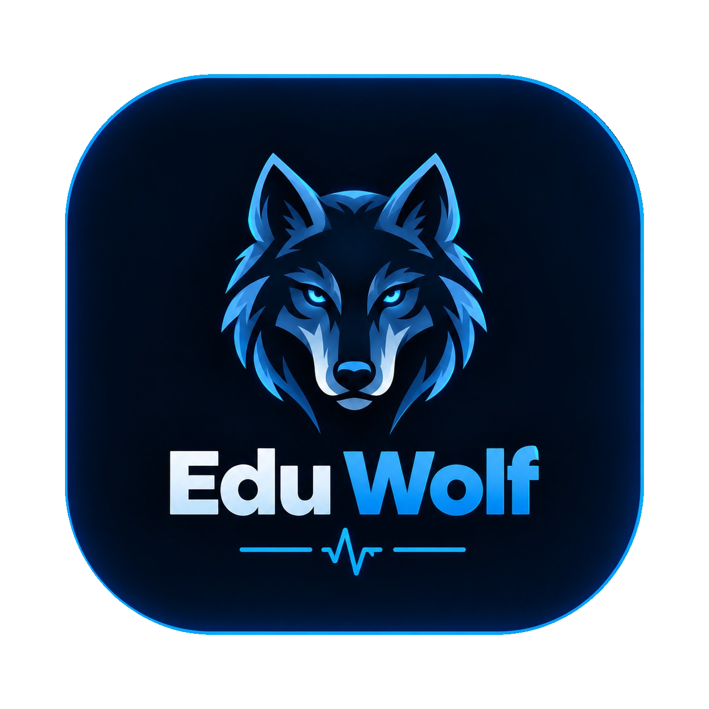
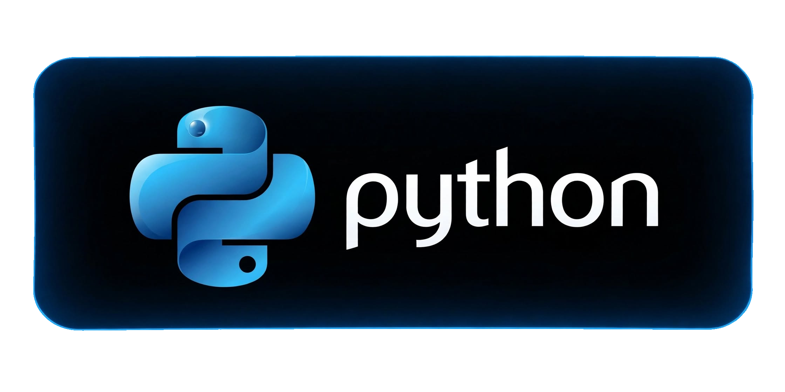
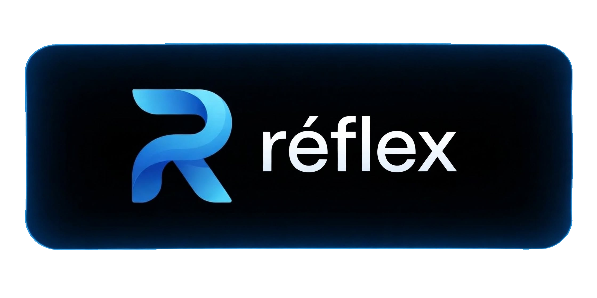
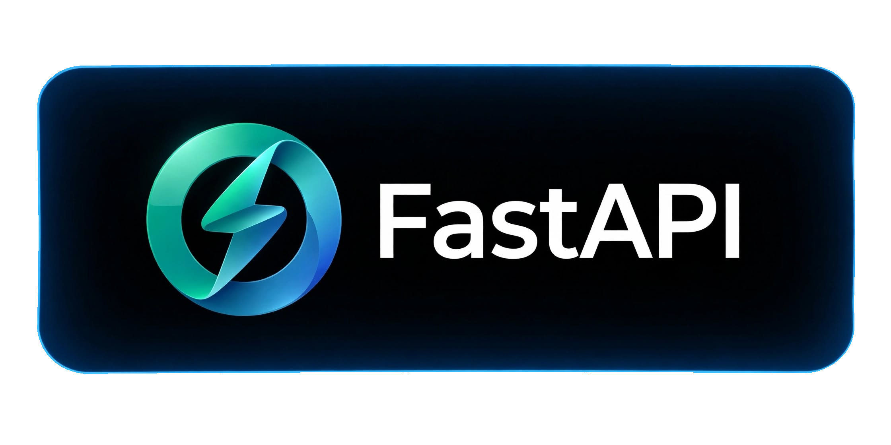
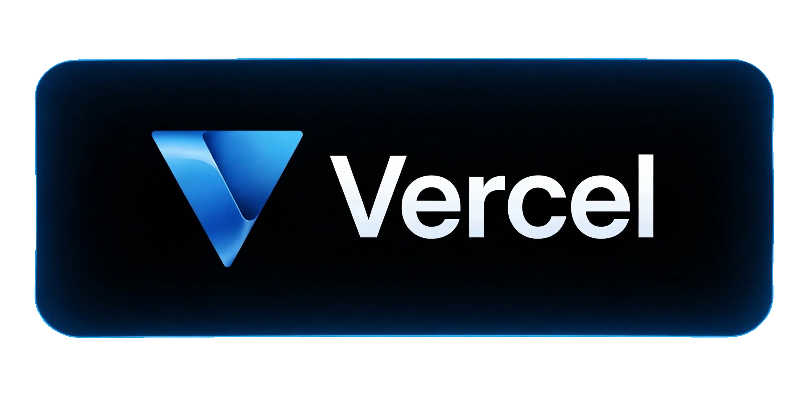
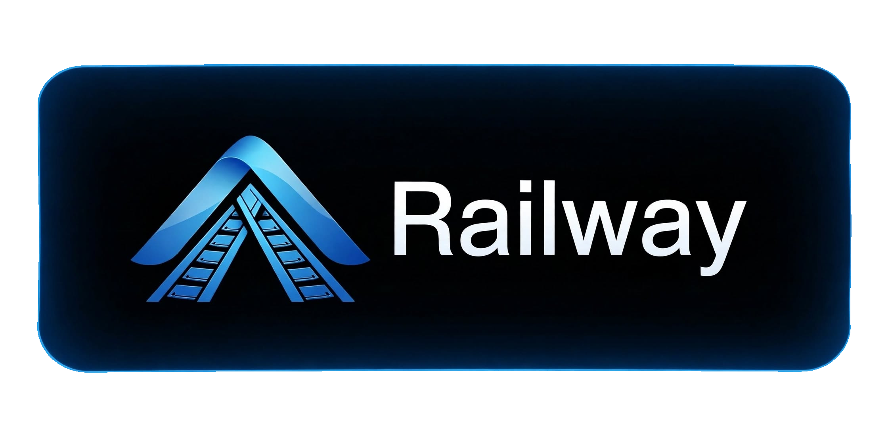
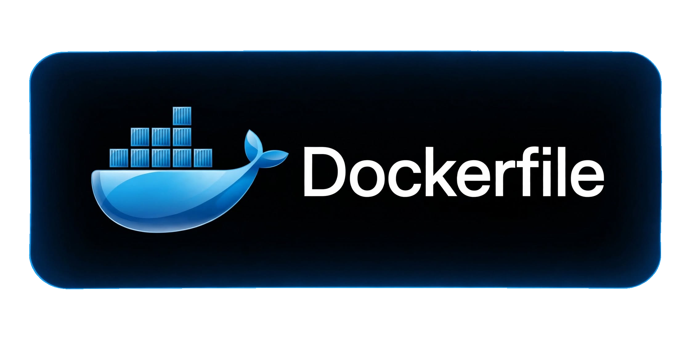
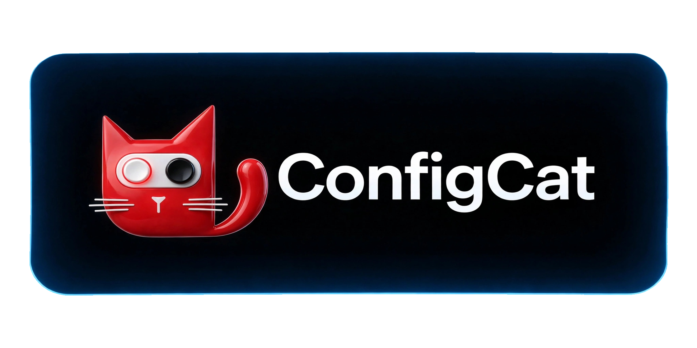
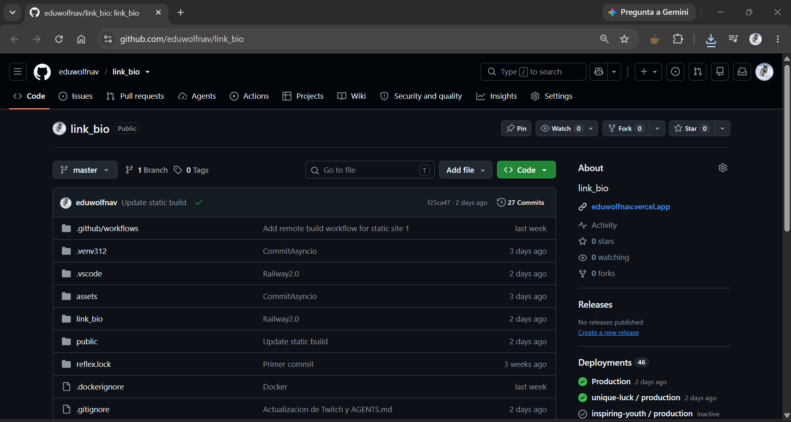
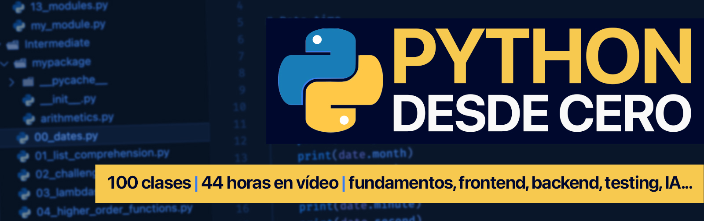

# 🐺 link_bio — Edu Wolf | Portfolio Full-Stack Python

<p align="center">
  
</p>

<p align="center">
  
  
  
  
  
  
  
  
  
</p>

<p align="center">
  <b>Python + Reflex + FastAPI + SQLModel + Supabase + Twitch API + ConfigCat + Vercel + Railway</b><br>
  Repo público para estudiar arquitectura limpia full-stack. 32 archivos, comentarios profesionales, case-sensitive safe.
</p>

<p align="center">
  <a href="https://github.com/eduwolfnav/link_bio">GitHub</a> •
  <a href="https://eduwolfnav.vercel.app">Demo Vercel</a> •
  <a href="https://eduwolfnav.up.railway.app">API Railway</a>
</p>

---

## 📸 Captura

<p align="center">
  
</p>

> **Stack visual:** Avatar + redes + experience count + featured (Supabase limit 2) + links + sponsors grid columns=[2,7] + live_schedule con timezone America/Santiago

---

## 🎯 Objetivo de aprendizaje

Este no es solo un link in bio. Es un laboratorio para dominar:

- **Reflex 0.9.12** frontend reactivo 100% Python (no JS)
- **FastAPI + SQLModel + Alembic** backend + DB
- **Estados async** `rx.State`, `asyncio.gather`, `to_thread`
- **Var reactiva** `rx.cond`, `rx.foreach` con `_dia_nombre` (Var no str)
- **APIs externas:** Twitch Helix OAuth, Supabase Postgres, ConfigCat Feature Flags
- **Deploy dual:** Vercel frontend estático + Railway backend Docker
- **Arquitectura limpia:** `colors/fonts -> styles -> components -> views -> api -> state -> pages -> link_bio.py`

---

## 🏗️ Arquitectura en Capas

```
CAPA 1 styles/          colors.py PRIMARY #14A1F0, fonts.py DEFAULT, styles.py BASE_STYLE + Size enum
   ↓
CAPA 2 components/      10 files: link_button (border-blink), link_icon (icon-blink), navbar, title, footer, featured_link (rx.cond), live_schedule (_dia_nombre)
   ↓
CAPA 3 views/           header.py 5 bloques (avatar+name, experience, social icons, 2 info_text), index_links 6 botones, courses_links, sponsors grid
   ↓
CAPA 4 api/ + model/    api.py Facade, TwitchAPI.py generate_token + live() -> Live, SupabaseAPI.py featured() -> List[Featured], ConfigCatAPI.py schedule() fallback default
   ↓
CAPA 5 state/           PageState.py rx.State global: is_loading, live_status, featured_info, live_schedule, timezone, next_live, set_timezone, load_index_data
   ↓
CAPA 6 pages/ + link_bio.py  index.py template on_mount TIMEZONE_SCRIPT + on_load load_index_data, courses.py, testasyncio.py, rx.App(STYLESHEETS animations.css)
```

Cada archivo tiene header `PROPÓSITO Y CÓMO SE CONECTA`.

---

## 🌐 Infraestructura y Despliegue - Flujo Ejecutivo Definitivo

### Diagrama ordenado (verde azulado=frontend, coral=backend, gris=control)

```
Tu PC (VS Code + local_build.sh + git push origin master)
   ↓
GitHub eduwolfnav/link_bio master (32 archivos, case-sensitive!)
   ↓ (avisa en paralelo a 3)
┌──────────────┬──────────────────┬─────────────────┐
│ Static Build │     Vercel       │     Railway     │
│ GitHub Actions│ Frontend #4DB6AC │ Backend #EF9A9A │
│ remote_build.yml│ eduwolfnav.vercel.app│ eduwolfnav.up.railway.app│
│ Ubuntu Python 3.13│ public/ → CDN  │ Dockerfile + Supabase│
│ REFLEX_API_URL=railway│               │               │
│ reflex export --frontend-only → frontend.zip → public/│
└──────┬───────┴────────┬─────────┴────────┬────────┘
       │                │                  │
       ↓                │                  │
Commit auto "Update static build" con public/ → master (loop)
                        ↓
                    Navegador carga Vercel y llama API Railway
                        ↓
                    Railway API → Supabase tabla featured + Twitch Helix /streams + ConfigCat flag live_schedule
```

**Validado real:** Vercel y Railway conectados directo a master, Railway autodetecta Dockerfile, SUPABASE_URL/PUBLISHABLE_KEY en Railway env.

### 7 pasos detallados

1. **PC:** Cambios VS Code, opcional `local_build.sh` (venv + pip install + export). `git pull` antes de push porque la acción agrega commit.
2. **GitHub push:** `git push origin master` dispara 3 piezas paralelo.
3. **Static Build:** `.github/workflows/remote_build.yml` corre Ubuntu Python 3.13, `REFLEX_API_URL=https://eduwolfnav.up.railway.app`, `remote_build.sh` instala deps, borra `public/`, `reflex init` + `reflex export --frontend-only` + extrae `frontend.zip` en `public/`.
4. **Commit auto:** Acción hace commit `Update static build` con `public/` y push a master.
5. **Vercel:** Publica frontend estático desde `public/` a `eduwolfnav.vercel.app`.
6. **Railway:** Construye backend Dockerfile, `pip install -r requirements.txt`, `reflex db migrate`, `reflex run --env prod` a `eduwolfnav.up.railway.app`.
7. **Producción:** Browser Vercel llama API Railway, Railway usa `SupabaseAPI.py` + `TwitchAPI.py` + `ConfigCatAPI.py` con fallbacks elegantes.

---

## 📦 Estructura 32 archivos exactos

```
link_bio/
├── rxconfig.py (app_name=link_bio, db_url sqlite:///reflex.db, api_url railway, cors vercel+localhost)
├── requirements.txt (reflex[db]==0.9.12, fastapi, python-dotenv, requests, supabase, configcat-client, tzdata, greenlet)
├── Dockerfile (backend Railway)
├── .github/workflows/remote_build.yml (Static Build)
├── local_build.sh / remote_build.sh
├── public/ (frontend estático generado - sirve Vercel)
└── link_bio/
    ├── link_bio.py (rx.App + BASE_STYLE)
    ├── constants.py (USER, LIVES, SPONSORS)
    ├── routes.py (Route INDEX=/, COURSES=/courses)
    ├── utils.py (is_valid_url, next_date, LOCAL_TIMEZONE_SCRIPT Intl.DateTimeFormat, index_title/meta/preview)
    ├── styles/ colors.py, fonts.py, styles.py
    ├── model/ Featured.py Pydantic, Live.py SQLModel table=True
    ├── components/ 10 files: ant_components, featured_link, footer, info_text, link_button, link_icon, link_sponsor, live_schedule, navbar, title
    ├── views/ header.py 5 bloques, index_links.py, courses_links.py, sponsors.py
    ├── api/ api.py Facade, TwitchAPI.py, SupabaseAPI.py, ConfigCatAPI.py
    ├── state/ PageState.py (is_loading, live_status, featured_info, live_schedule, timezone)
    ├── pages/ index.py on_mount TIMEZONE_SCRIPT + on_load load_index_data, courses.py, testasyncio.py
    └── assets/ (17 elementos) → ver abajo
        ├── icons/ (github, python, reflex, etc)
        ├── animations.css (border-blink + icon-blink)
        ├── responsive.css
        ├── avatar.png (wolf)
        ├── favicon.ico
        ├── eduwolf_logo.png
        └── captura_linkbio.png
```

<p align="center">
  
  
  
  
  
  
  
  
</p>

---

## ⚡ Flujo Reactivo (Reflex State)

```
1. Browser on_mount LOCAL_TIMEZONE_SCRIPT (JS Intl.DateTimeFormat().resolvedOptions().timeZone)
2. PageState.set_timezone(timezone) -> America/Santiago
3. on_load load_index_data is_loading=True skeleton
4a. await TwitchAPI.live() OAuth POST id.twitch.tv/oauth2/token client_credentials -> GET helix/streams?user_login
4b. gather to_thread SupabaseAPI.featured() select order asc limit 2 -> [Featured]
4c. gather to_thread ConfigCatAPI.schedule() get_value flag JSON fallback default
5. set state live_status, featured_info, live_schedule, next_live=next_date(schedule,timezone)
6. is_loading=False -> header() badge morado si live, featured_link() rx.cond, live_schedule() rx.foreach + _dia_nombre rx.cond anidado (Var)
```

Aprendizaje: `async + to_thread` no bloquea event loop, `rx.cond` para Var.

---

## 🚀 Primeros Pasos (bloques cronológicos)

```bash
# BLOQUE 0 - Requisitos
python --version # 3.11+
pip --version
git --version
node --version

# BLOQUE 1 - Clonar
git clone https://github.com/eduwolfnav/link_bio.git
cd link_bio

# BLOQUE 2 - Venv
python -m venv .venv
.venv\Scripts\activate # Windows
# source .venv/bin/activate # Linux/Mac

# BLOQUE 3 - Deps desde requirements.txt
pip install --upgrade pip
pip install -r requirements.txt
# contiene: reflex[db]==0.9.12, fastapi, python-dotenv, requests, supabase, configcat-client, tzdata
pip install greenlet # si falta
pip freeze
reflex --version

# BLOQUE 4 - .env (no subir a GitHub)
# Crear .env en raiz al lado rxconfig.py
SUPABASE_URL=https://tu-proyecto.supabase.co
SUPABASE_PUBLISHABLE_KEY=tu_key
TWITCH_CLIENT_ID=xxx
TWITCH_CLIENT_SECRET=yyy
CONFIGCAT_SDK_KEY=zzz

# BLOQUE 5 - Init Reflex (solo primera vez si no hay .web)
reflex init

# BLOQUE 6 - DB
reflex db init
reflex db makemigrations
reflex db migrate

# BLOQUE 7 - Run local
reflex run
# Frontend http://localhost:3000
# Backend http://localhost:8000

# BLOQUE 8 - Reflex utiles
reflex export # para Vercel
reflex build

# BLOQUE 9 - GitHub diario
git status
git add .
git commit -m "feat: ..."
git push origin master
git pull origin master # importante por commit auto

# BLOQUE 10 - Deploy ya configurado
# Vercel auto deploy desde public/
# Railway auto deploy desde Dockerfile
```

---

## 🔐 Variables de Entorno y Fallbacks

| Variable | Uso | Fallback si falta | Obligatoria |
|---|---|---|---|
| SUPABASE_URL | SupabaseAPI.featured() | [] lista vacía | No |
| SUPABASE_PUBLISHABLE_KEY | SupabaseAPI | [] | No |
| TWITCH_CLIENT_ID | TwitchAPI token | Live(live=False) | No |
| TWITCH_CLIENT_SECRET | TwitchAPI | Live(False) | No |
| CONFIGCAT_SDK_KEY | ConfigCatAPI | dict default L-D 19-20h | No |

Principio: **App nunca rompe si falta env var**. `dotenv.load_dotenv()` en cada API. En Vercel/Railway configurar en Dashboard Environment Variables.

---

## 📚 Patrones de estudio

1. **Separación responsabilidades:** styles solo diseño, components UI atómica, views composición, api fetch, state lógica, pages orquestación.
2. **Var reactiva:** `_dia_nombre` usa `rx.cond` anidado porque key es Var no str.
3. **Async + Threads:** `load_index_data` mezcla `await` + `to_thread` para no bloquear.
4. **SEO:** `utils.py` `index_title`, `description`, `meta`, `preview`, `lang()`.
5. **Animaciones CSS pura:** `border-blink` e `icon-blink` en `animations.css` + `responsive.css`.
6. **Case-sensitive bug:** `reflex.png` vs `Reflex.jpg` rompe en Railway Linux.
7. **Reflex DB:** `Live` `SQLModel table=True` requiere `reflex[db]` + `greenlet`.
8. **Static Build:** `public/` generado por Action, Vercel no buildea Reflex, solo sirve `public/`.
9. **Watch Paths:** Ignorar `public/**` en Railway para no reiniciar backend innecesario.

---

## 🗂️ Qué hace cada servicio

| Servicio | Rol | Se activa con | Resultado |
|---|---|---|---|
| GitHub | Control versiones | git push master | eduwolfnav/link_bio |
| GitHub Actions Static Build | Construye public/ | push master | commit Update static build |
| Vercel | Frontend estático | commits public/ | eduwolfnav.vercel.app |
| Railway | Backend API Dockerfile | commits repo | eduwolfnav.up.railway.app |
| Supabase | DB tabla featured | llamada API Railway | datos featured |
| Twitch API | Live status | llamada API Railway | badge En vivo |
| ConfigCat | Flag live_schedule | llamada API Railway | horario sin redeploy |

---

## 🎨 Assets

Todos en `assets/` normalizados hace 16h commit `Normalizacion`:

- `eduwolf_logo.png` - Logo lobo azul 736KB
- `avatar.png` - Avatar wolf
- `favicon.ico`
- `python.png`, `reflex.png`, `fastapi.png`, `supabase.png`, `vercel.png`, `railway.png`, `github.png`, `dockerfile.png`, `configcat.png`, `cursopython.jpg`
- `captura_linkbio.png` - Screenshot proyecto
- `animations.css` + `responsive.css` - Keyframes
- `icons/` - Iconos redes

---

## 🚢 Recomendaciones ejecutivas

- **Haz `git pull` antes de push.** La acción agrega commit auto a master y deja local atrasado.
- **Watch Paths Railway ignorar `public/**`.** Commit auto solo cambia esa carpeta, backend no necesita reinicio.
- **Si Railway no aparece activo, Redeploy manual.**
- **Mantén `.env` fuera de GitHub.**
- **Case-sensitive:** `rxconfig.py` no `Rxconfig.py`.
- **Dockerfile:** Validado Railway autodetecta y usa Dockerfile para backend.

---

## 📈 Próximos pasos estudiante

1. Clona y sigue Primeros Pasos bloque por bloque.
2. Cambia `sponsors.py` agrega tu tecnología.
3. Crea `pages/portfolio.py` con `Route.PORTFOLIO`.
4. Crea `model/Project.py` SQLModel y muestra en Supabase.
5. Implementa cache ConfigCat `lru_cache 5min`.
6. Tests `pytest` para `utils.next_date` + `is_valid_url`.
7. Dockeriza local: `docker build -t link_bio .`
8. GitHub Actions CI: lint + pytest + build.

---

## 📄 Licencia y Créditos

Proyecto de estudio público por **Edu Wolf (@edu.wolf.nav)**  
Basado en curso Python de MouredeV, adaptado a arquitectura limpia full-stack.

> **En los detalles está la gracia.** Cada archivo documentado con `PROPÓSITO Y CÓMO SE CONECTA`.

<p align="center">
  
  <br>
  Hecho con 🐺 y Python
</p>
